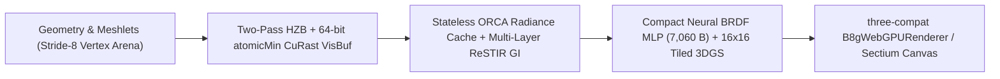

# B8G Next-Gen Graphics Engine (`b8g-graphics`)

> **Zero-Copy Sovereign Graphics Subsystem** — unifying a 64-bit `atomicMin` CuRast/Nanite Visibility Buffer (`B8G_ARENA_V1`), Two-Pass HZB occlusion culling, SIGGRAPH 2026 Stateless ORCA Radiance Cache + Multi-Layer ReSTIR GI, an L1/workgroup-resident Neural BRDF MLP (`7,060 B <= 8,192 B`), Tile-Based 3D Gaussian Splatting (`3DGS`), a zero-header C11 `-O3` ABI, and a thin Three.js-compatible adapter under `erasableSyntaxOnly: true`.

---

## Rendering Pipeline



---

## Verified File Inventory

| File | Role | Key Primitives / Contracts |
| :--- | :--- | :--- |
| [`index.mts`](index.mts) | Public barrel export | Re-exports all rasterizer, GI, neural/3DGS, and `three-compat` APIs |
| [`visibility-rasterizer.mts`](visibility-rasterizer.mts) | Software Visibility Buffer & HZB culler | `VisibilityBufferArena` (`B8G_ARENA_V1`), `packVisibilityId`, `unpackVisibilityId`, `rasterizeMicropolygons64`, `buildHzbPyramid`, `cullMeshletsTwoPassHzb`, `computeAnalyticalBarycentrics`, `evaluateBindlessVisibilityPass` |
| [`orca-restir-gi.mts`](orca-restir-gi.mts) | Stateless GI & Multi-Layer ReSTIR | `OrcaStatelessRadianceCache` (`ORCA_MAX_PROBE = 16`), `hashCellKey`, `computeNeighborCompatibility`, `MultiLayerReservoirBuffer` (`RESERVOIR_STRIDE = 13`) |
| [`neural-material-3dgs.mts`](neural-material-3dgs.mts) | Neural BRDF MLP & Hybrid 3DGS | `CompactNeuralBrdfMlp` (`16 -> 32 -> 32 -> 5`, `7,060 B`), `createDefaultNeuralMaterial`, `evaluateNeuralBrdf`, `TileBased3dgsRenderer` (`GAUSSIAN_STRIDE = 14`), `projectAndBinGaussians`, `composite3dgsHybrid` |
| [`three-compat.mts`](three-compat.mts) | Thin Three.js-compatible drop-in adapter | `Scene`, `PerspectiveCamera`, `BoxGeometry`, `PBRMaterial`, `NeuralMaterial`, `GaussianSplatMesh`, `B8gWebGPURenderer`, `encodeRgbaToBmp24` |
| [`b8g_graphics_abi.h`](b8g_graphics_abi.h) | Zero-header C11 ABI contract | `<stddef.h>` + `<stdint.h>` only; `_Static_assert`-verified structs & `B8gGraphicsDispatchTable` |
| [`b8g_graphics_core.c`](b8g_graphics_core.c) | C11 `-O3` hot-path kernels | `b8g_visbuf_pack64`, `b8g_hzb_downsample_2x2`, `b8g_orca_hash_cell`, `b8g_restir_neighbor_compatible`, `b8g_neural_brdf_eval`, `b8g_3dgs_eval_tile_gaussian`, `b8g_graphics_init_dispatch_table` |
| [`abi-golden.json`](abi-golden.json) | Binary layout golden manifest | `holo-abi-golden.v1` exact `sizeof`, `alignof`, `offsets`, and magic constants |
| [`shaders/visbuf-curast.wgsl`](shaders/visbuf-curast.wgsl) | WebGPU Visibility Buffer compute pipeline | Split `visBufferHi`/`visBufferLo` atomics, Two-Pass HZB culling, analytical `ddx`/`ddy` bindless resolve |
| [`shaders/orca-restir.wgsl`](shaders/orca-restir.wgsl) | WebGPU ORCA + ReSTIR compute pipeline | `OrcaCell` atomic fixed-point radiance accumulation + `RESERVOIR_STRIDE = 13` reservoir splatting |
| [`shaders/neural-brdf-3dgs.wgsl`](shaders/neural-brdf-3dgs.wgsl) | WebGPU Neural BRDF + 3DGS compositing | `var<workgroup> shared_mlp: array<f32, 1765>` (`7,060 B`) + tiled 3DGS alpha compositing against `vis_buffer` depth |
| [`b8g-graphics.test.mts`](b8g-graphics.test.mts) | End-to-end engine & C11 compile test suite | Verifies 64-bit visbuf, ORCA/ReSTIR, Neural BRDF + 3DGS BMP render, WGSL `@compute`, and `-std=c11 -O3 -Wall -Wextra -Werror` compilation |
| [`abi-golden.test.mts`](abi-golden.test.mts) | ABI layout & kernel parity test suite | Compiles C11 probe via `zig cc` (`cc`/`gcc`/`clang` fallback) and asserts exact parity with `abi-golden.json` |

---

## Core Architecture

1. **64-bit CuRast Visibility Buffer & Two-Pass HZB (`visibility-rasterizer.mts`, `shaders/visbuf-curast.wgsl`):**
   - `VisibilityBufferArena` allocates one 64-byte-aligned `SharedArrayBuffer` (`B8G_ARENA_V1`) holding `visBuf` (`BigUint64Array`, cleared to `VISBUF_CLEAR_VALUE = 0xffffffffffffffffn`), `vertices` (`Float32Array`, `VISBUF_VERTEX_STRIDE = 8`: `x, y, z, w, u, v, nx, ny`), `indices` (`Uint32Array`), and `depthBuf` (`Float32Array`).
   - `packVisibilityId(depthU32, instanceId, triangleId)` places 32-bit unsigned depth in the high bits so front-to-back ordering reduces to a single 64-bit `atomicMin`.
   - `cullMeshletsTwoPassHzb` tests meshlets against the prior frame's `HzbPyramid` (Pass 1) and recovers disoccluded geometry (Pass 2); `evaluateBindlessVisibilityPass` uses `computeAnalyticalBarycentrics` for exact screen-space `duDx`, `dvDx`, `duDy`, `dvDy` derivatives without 2×2 pixel-quad helper lanes.

2. **Stateless ORCA Radiance Cache & Multi-Layer ReSTIR GI (`orca-restir-gi.mts`, `shaders/orca-restir.wgsl`):**
   - `OrcaStatelessRadianceCache` maps quantized world-space coordinates and surface normals into a fixed power-of-two open-addressed hash table (`ORCA_MAX_PROBE = 16`) with `O(1)` per-frame `resetFrame()` clearing temporal history to zero out ghosting.
   - `computeNeighborCompatibility` enforces `maxPlaneDist` and `minNormalDot` geometric compatibility to block light leaks across thin walls, while `MultiLayerReservoirBuffer` (`RESERVOIR_STRIDE = 13` floats per pixel per layer) promotes occluded background layers on foreground disocclusion (`resolveDisoccludedPixel`).

3. **Compact Neural BRDF MLP & Hybrid 3D Gaussian Splatting (`neural-material-3dgs.mts`, `shaders/neural-brdf-3dgs.wgsl`):**
   - `CompactNeuralBrdfMlp` evaluates a `16 -> 32 -> 32 -> 5` sinusoidal-encoded MLP (`NEURAL_MLP_WEIGHT_COUNT = 1765` floats = `7,060 B <= 8,192 B` `NEURAL_MLP_MAX_BYTES`), fitting inside GPU `var<workgroup>` shared memory to synthesize `[albedoR, albedoG, albedoB, roughness, metallic]`.
   - `TileBased3dgsRenderer` stores `GAUSSIAN_STRIDE = 14` floats per splat (`px..pz, sx..sz, qx..qw, r, g, b, opacity`), projects 3D covariance conics into `16x16` screen tiles (`projectAndBinGaussians`), depth-sorts front-to-back per tile, and composites (`composite3dgsHybrid`) with early termination against Visibility Buffer depth (`splat.depth > visDepth`).

---

## Thin Three.js-Compatible Drop-In Adapter (`three-compat.mts`)

Instead of forking upstream Three.js or carrying bundler/transpiler dependency trees, `three-compat.mts` provides a **zero-bloat, `erasableSyntaxOnly: true` adapter** with zero external or `node:*` imports. Scene data writes directly into `VisibilityBufferArena` (`B8G_ARENA_V1`) and drives the full hybrid pipeline (`B8gWebGPURenderer.render` / `renderToBmp`).

Exported symbols in [`three-compat.mts`](three-compat.mts):
- **Math & Camera:** `Vector3`, `Matrix4`, `PerspectiveCamera`
- **Geometry & Materials:** `BufferGeometry`, `BoxGeometry`, `PBRMaterial`, `NeuralMaterial`
- **Scene Graph & Splats:** `Mesh`, `GaussianSplatMesh`, `Scene`
- **Renderer & Output:** `B8gWebGPURenderer`, `encodeRgbaToBmp24`, plus result interfaces `HybridRenderStats` and `BmpHybridRenderResult`

---

## C11 ABI Golden Contract (`b8g_graphics_abi.h` & `abi-golden.json`)

[`b8g_graphics_abi.h`](b8g_graphics_abi.h) includes only `<stddef.h>` and `<stdint.h>` and verifies all struct sizes, alignments, and field offsets at compile time with `_Static_assert` against [`abi-golden.json`](abi-golden.json) (`schema: "holo-abi-golden.v1"`):

- **ABI Constants:** `B8G_GRAPHICS_ABI_MAGIC = 0x58464742` (`"BGFX"`), `B8G_GRAPHICS_ABI_VERSION = 1`, `B8G_ABI_MAGIC_V3 = 0x33564742` (`"BGV3"`).
- **Capability Flags:** `B8G_GRAPHICS_CAP_VISBUF` (`1`), `B8G_GRAPHICS_CAP_ORCA_GI` (`2`), `B8G_GRAPHICS_CAP_RESTIR` (`4`), `B8G_GRAPHICS_CAP_NEURAL_BRDF` (`8`), `B8G_GRAPHICS_CAP_3DGS_HYBRID` (`16`).
- **Binary Structs:**
  - `B8gVisBufHeaderC` (`32 B`, `alignof = 4`)
  - `B8gMeshletBoundsC` (`64 B`, `alignof = 4`)
  - `B8gOrcaCellC` (`32 B`, `alignof = 4`)
  - `B8gReservoirLayerC` (`48 B`, `alignof = 4`)
  - `B8gGaussianSplatC` (`64 B`, `alignof = 4`)
  - `B8gGraphicsDispatchTable` (`64 B`, `alignof = 8`, initialized via `b8g_graphics_init_dispatch_table` with `pack64`, `hzb_downsample_2x2`, `orca_hash_cell`, `restir_neighbor_compatible`, `neural_brdf_eval` [C11 `5 -> 8 -> 5` micro-MLP], and `eval_tile_gaussian`).

---

## Verification (`node --test`)

Run both hermetic test suites directly on Node 22+ (zero build step):

```powershell
# From awesome-os root:
.\bin\node.ps1 --test sections/b8g-graphics/b8g-graphics.test.mts sections/b8g-graphics/abi-golden.test.mts

# Or from awesome-os/devtools root:
node --test ide/game-engines/b8g-graphics/b8g-graphics.test.mts ide/game-engines/b8g-graphics/abi-golden.test.mts
```
